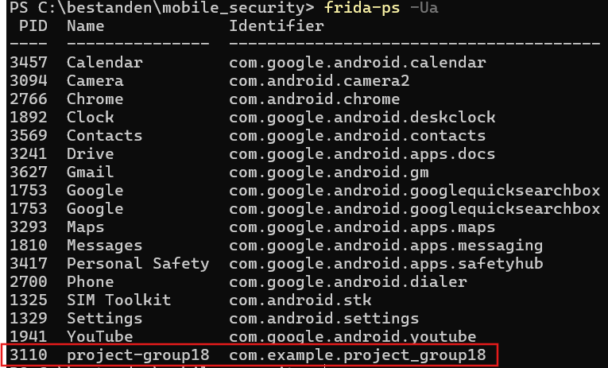
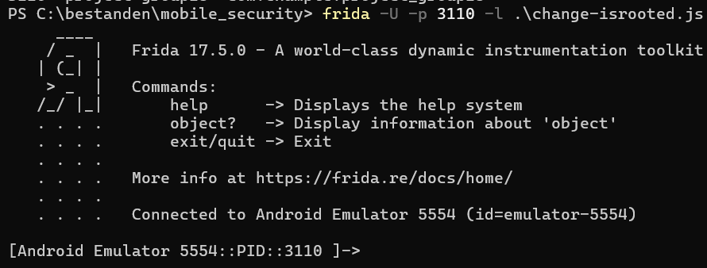
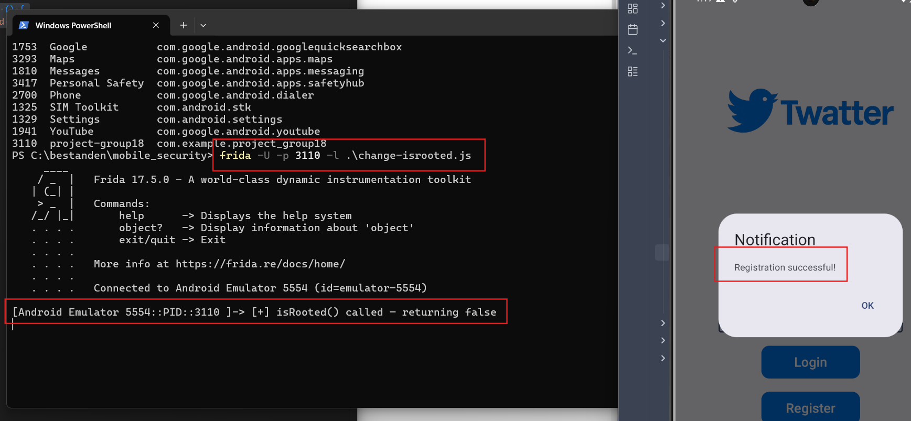

i wrote this java script to bypass the isRooted value when the function registerUser is executed:

```
Java.perform(function () { //this tells frida: run this code inside Android app's Java VM, when its ready
    var VM = Java.use("com.example.project_group18.ui.login.LoginScreenViewModel"); //loads java class reference from running app

    VM.isRooted.implementation = function () { //refers to isRooted value in code and replaces it with the function below
        console.log("[+] isRooted() called — returning false");// logs in the console when the isRooted is called, e.g. when clicking registration button
        return false; //replaces the original isRooted to be always false 
    };
});
```

using frida you can use this script to bypass the root check in the function:
- open the app
- in cmd run: 
	- `adb root`
- then start the frida server: 
	- `adb shell "/data/local/tmp/frida-server-17.5.0-android-x86_64 &"`
- then in another cmd run: 
	- `frida-ps -Ua`
	- 
- then use this command to attach to the running app with the .js script:
	- `frida -U -p 3110 -l .\change-isrooted.js`
	- 
- now when you create an account on the app even if your device is rooted it will work
	- 