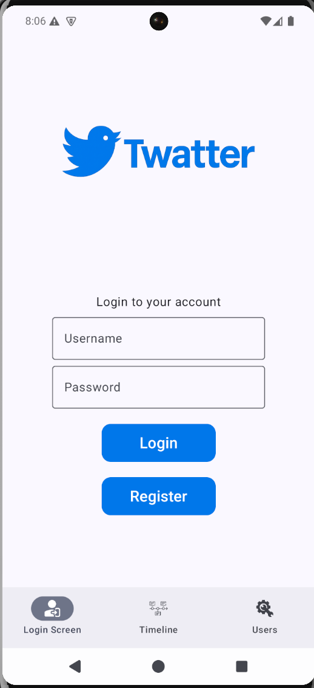
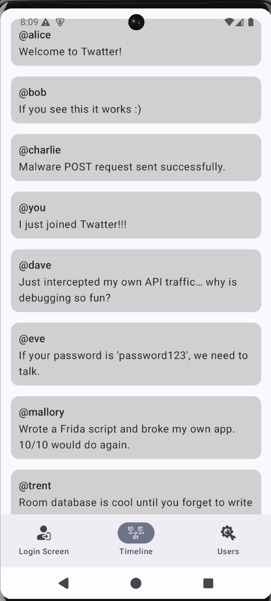
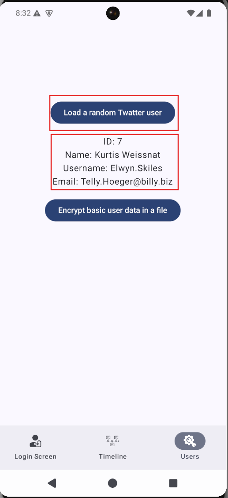
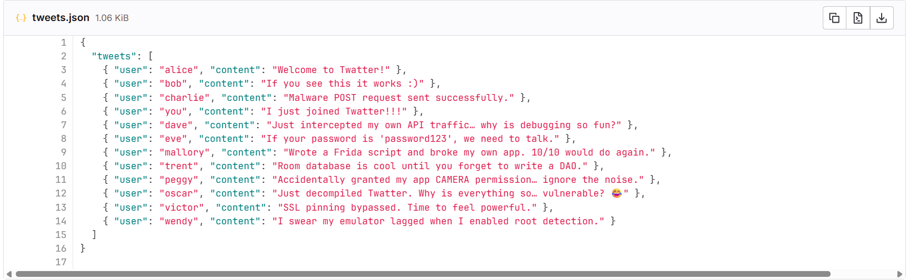
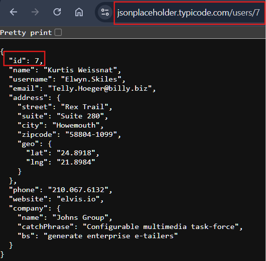
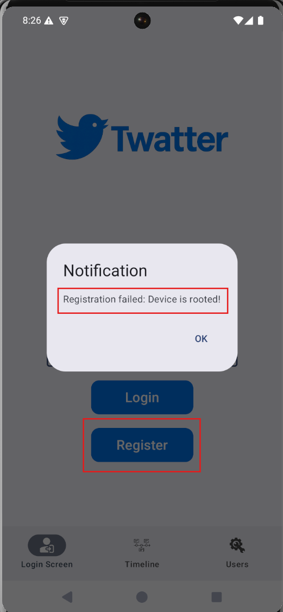
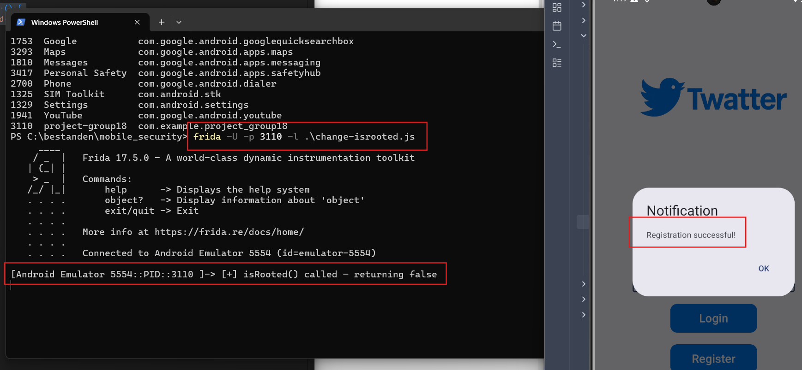

# Mobile Security project -  documentation

## Groupmember
1. Yentl Sinnaeve
2. Aykan Ridvanov
3. Lowie Callebaut

## Project summary
A brief summary about the application

## Requirements
### ℹ️ Legend
- ✔️ = Implemented
- ❌ = Not implemented
- ⌛ = Work in progress

 
| Status | Description                     | Details |     |
| --- | --------------------------------| ------- | --- |
|✅| **Application**                       |         |     |
|✔️| 2 UI screens                          |         |     |
|✔️| Secure API request<br>                |         |     |
|✔️| API request with IDOR                 |         |     |
|✔️| Connection to room database           |         |     |
|✔️| Secure storage                        |         |     |
| |                                         |         |     |
|✅ | **Security**                         |         |     |
|✔️| Unsafe storage                        |         |     |
|✔️| Malware                               |         |     |
|✔️| Frida functionality                   |         |     |
|⌛| Functionality change decompile compile|         |     |
|✔️| Detect root and block functionality   |         |     |
| |                                       |         |     |


## Overview app
Describe the implementation of the following topics.

###  Screenshots
#### First Screen: Login Screen
* This screen is meant to login to the app using the Room database
* 
#### Second Screen: Timeline Screen
* This Screen is used to render the timeline off the app making a request to a file
* 
#### Third Screen: Users Screen
* This Screen is used to request a random Twatter user thats pulled from a json file online
* 


###  Secure API request
#### The app makes a request to a .json file in a gitlab repository linked at: 
```https://gitlab.ti.howest.be/aykan.ridvanov/api_project_mobile/-/raw/main/tweets.json?ref_type=heads```
* 
* This gets displayed at the TimelineScreen in the application
* It is possible to intercept the request using burpsuite but when you try to modify it it doesn't work


###  API request with IDOR
#### The app makes a request to another .json file stored in:
```https://jsonplaceholder.typicode.com/users/{id}```
* 
* This is displayed at the UserScreen
* 
* When intercepting this request using burp suite you can change the id and you will get another user instead of a random user   


###  Room database
Type of data stored in the database used in screen x and displayed in screen y.


###  Secure storage
Type of data stored used in screen x and displayed in screen y.


###  Unsecure storage
Type of data stored used in screen x and displayed in screen y.


###  Malware
Implementation of malware.


###  Root
#### Root gets detected when trying to use the register button on the login screen
* This is done using the imported module RootBeer
* 

###  Frida
#### Using Frida we bypassed the root detection that's blocks a functionality
* The Following script was used in frida
```
Java.perform(function () {
    var VM = Java.use("com.example.project_group18.ui.login.LoginScreenViewModel");
    VM.isRooted.implementation = function () {
        console.log("[+] isRooted() called — returning false");
        return false;
    };
});
``` 
* The following command is used to attach the script to the application
```
frida -U -p 3110 -l .\change-isrooted.js
```



## Link to Panopto video
https://


## Repositories
- Code
  - https://gitlab.ti.howest.be/ti/2025-2026/s3/mobilesecurity/students/group-18/project_group18/-/tree/b2f5ac4fe4b4009145c9ce4730e669c9a2eccb80/
- APK
  - [Link to repository]