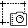

# Mobile Security project -  documentation

## Groupmember
1. Yentl Sinnaeve
2. Aykan Ridvanov
3. Lowie Callebaut

## Project summary
A brief summary about the application

## Requirements
### ℹ️ Legend
- ✔️ = Implemented
- ❌ = Not implemented
- ⌛ = Work in progress

 
| Status | Description                         | Details |     |
|--------| ----------------------------------- | ------- | --- |
| ⌛      | **Application**                     |         |     |
| ✔️     | 2 UI screens                        |         |     |
|        | Secure API request               |         |     |
|        | SSL pinning (Bonus)                 |         |     |
|        | API request with IDOR               |         |     |
| ⌛      | Connection to room database         |         |     |
| ✔️     | Secure storage                      |         |     |
|        |                                     |         |     |
|        | **Security**                        |         |     |
|        | Unsafe storage                      |         |     |
|  ✔️    | Malware                             |         |     |
|        | Frida functionality                 |         |     |
|        | Detect root and block functionality |         |     |
|        |                                     |         |     |

## Overview app
Describe the implementation of the following topics.

###  Screenshots
Give screenshots for every screen in the application. Give each screen an unique name.

###  Secure API request
Request to server x retrieving JSON in the following format displayed in screen x.

###  API request with IDOR
Request to server x retrieving JSON in the following format displayed in screen x.

###  Room database
Type of data stored in the database used in screen x and displayed in screen y.

###  Secure storage
Type of data stored used in screen x and displayed in screen y.

###  Unsecure storage
Type of data stored used in screen x and displayed in screen y.

###  Malware
Implementation of malware.

###  Frida
Detail implementation of Frida

###  Root
Implementation of the detecting root and block functionality.

## Link to Panopto video
https://

## Repositories
- Code
  - https://gitlab.ti.howest.be/ti/2025-2026/s3/mobilesecurity/students/group-18/project_group18/-/tree/b2f5ac4fe4b4009145c9ce4730e669c9a2eccb80/
- APK
  - [Link to repository]